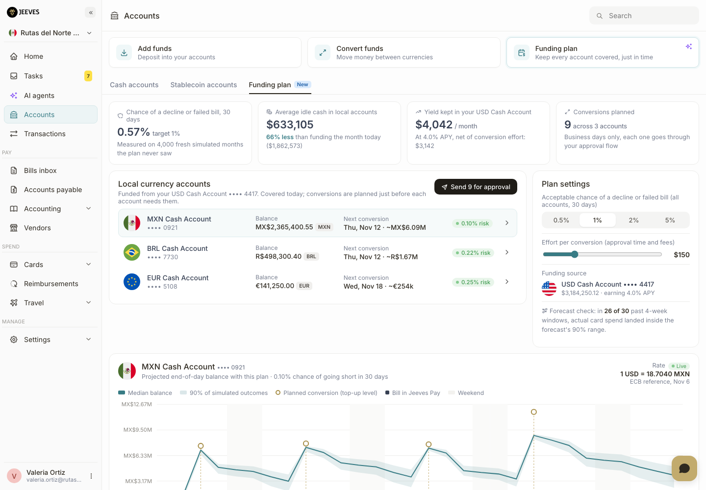

# Jeeves Funding plan (concept)

**Live demo:** https://mohith26.github.io/jeeves-funding-plan/

An unofficial concept feature for [Jeeves](https://www.tryjeeves.com): a **Funding plan** tab on the Accounts page that tells a finance team *when* to convert money out of its yield-earning USD Cash Account into each local-currency account (MXN, BRL, EUR), and *how much*, so that cards don't decline and bills don't fail, while as little cash as possible sits idle outside the account that earns yield.

Built by Mohith Gajjela. Not affiliated with Jeeves. The company, card spend and bills are synthetic; FX history is real (ECB reference rates).



## Why

Jeeves customers hold cash in several currencies and pay cards and suppliers out of each one, while the USD Cash Account earns yield (Jeeves advertises up to 5%). Today a treasurer either pre-funds each local account for the month (safe, but a lot of idle cash) or tops up when a balance looks low (cheap, but a weekend of fuel-card spend or an unexpected invoice can empty an account). Jeeves' own pages say to "convert funds between your Jeeves Cash accounts when exchange rates are favourable", which is a manual call. There is no forecast-driven plan that answers "how much, and by when, for this risk level".

## What it does

For each local account, over the next 30 days:

1. **Forecasts outflows.** Card spend is resampled week by week from the account's last 26 weeks (weekday shape, month-start bump, log-linear trend and level uncertainty). Scheduled Jeeves Pay bills are added on their dates; Bills-inbox invoices are added with a probability and a date window.
2. **Prices every schedule.** For every pair of business days (i, j), the simulation gives the spend between them. Topping up to the q-quantile of that spend protects that stretch. A shortest-path DP over business days picks the conversion days that minimise *forgone yield on idle local cash + an effort cost per conversion*.
3. **Calibrates the risk.** q is searched so that the chance of *any* shortfall over the month meets the user's target. The company-level target is split evenly across accounts (union bound). Cross-fitting (quantiles from one half of 6,000 simulated months, risk scored on the other half) plus a finite-sample `(k+1)/(n+1)` correction keep the selection step from overfitting.
4. **Checks on data it never saw.** The plan is replayed on 4,000 fresh simulated months per account, and the spend forecast is backtested on the account's own history (rolling origins, 4-week totals vs the 90% band).

Two baselines are tuned to the same target on the same simulations: **fund the month today** (one conversion sized to the 30-day forecast) and an **auto top-up rule** (top up to N days of average spend when below M days, with M/N scaled per account until it meets the target).

## Results on the demo company (1% target, `node scripts/report.mjs`)

| Strategy | Chance of any decline (held out) | Avg idle local cash | Yield forgone, 30 days | Conversions |
|---|---|---|---|---|
| Fund the month today | 0.72% | $1,862,573 | $6,124 | 3 |
| Auto top-up rule | 1.17% | $787,766 | $2,590 | 8.4 |
| **Funding plan** | **0.57%** | **$633,105** | **$2,082** | 9 |

The plan parks **66% less idle cash** than funding the month up front, keeping about **$4,000 a month** more yield in USD at 4% APY, and it stays under the risk target on held-out simulations (the auto top-up rule, tuned on the same data, slightly overshoots). The forecast check lands 26 of 30 past 4-week windows inside its 90% band (target 27), which is the honest weak spot: rare large card tickets make the BRL account hardest to forecast.

Every number on the page is computed in the browser by the same modules (`src/`) from the seeded generator.

## Code

- `src/generate.js`: seeded synthetic company (history, bills, inbox, balances)
- `src/forecast.js`: spend model fit, block-bootstrap outflow simulation, FX bootstrap
- `src/plan.js`: segment table, DP schedule, rule evaluation, calibration, baselines
- `src/model.js`: orchestration, held-out scoring, backtest
- `src/fxdata.js`, `data/fx_usd.json`: ECB reference rates, Nov 2024 to Nov 2026 (`scripts/fetch_fx.sh`)
- `app.js`, `index.html`, `styles.css`: the Accounts page UI (no build step)

## Tests

```
node --test test/plan.test.mjs
```

9 tests: deterministic generator, quantile definition, shortfall accounting, **DP equals brute force over every schedule** on a small instance, order-up-to shortfall logic, forecast unbiased on a clean series, FX paths frozen on weekends, **held-out risk within 3 standard errors of the target at 1% and 5%** with the plan idling less than both baselines, and forecast backtest coverage.

## Honest limitations

- Synthetic company. Real card spend has merchant- and cardholder-level structure (fuel cycles, travel seasons) this model does not use.
- Accounts are simulated independently, so the union bound is conservative; correlated spend shocks across countries are not modelled.
- Conversions are assumed to settle the same business day at today's rate. The plan does not try to time FX; the USD column uses today's rate.
- Local-currency balances are assumed to earn nothing and USD Cash 4.0% APY. The "effort per conversion" is a user-set dollar value, not a measured cost.
- Forecast coverage (26/30) is a little under nominal on this data.

## Novelty note

Checked Jeeves' help center (all 74 articles via the public Zendesk API), product pages (Global Accounts, Cross-border payments, AP), the Jeeves 2.1 and 3.0 release notes, the Sept 29, 2026 funding announcement and the AI Token Spend launch posts: Jeeves offers real-time FX conversion, scheduled payments and yield on USD balances, and recommends converting "when exchange rates are favourable", but nothing that forecasts per-account outflows or plans conversions. A third-party product comparison (ultrametric.ai) also found no documented auto top-up or low-balance alerting. Mercury and Ramp have threshold-based auto-transfer rules; Kyriba and other TMS tools do cash forecasting for large treasuries. The forecast-driven, risk-calibrated conversion schedule across currency accounts with a yield trade-off is the new part here.
